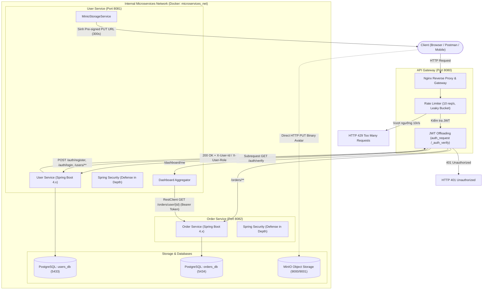

# Hệ Thống Microservices với API Gateway Nginx, JWT Offloading, Rate Limiting & MinIO Storage

Dự án Microservices được xây dựng bằng **Java 21**, **Spring Boot**, **PostgreSQL**, **Nginx Open Source Gateway** và **MinIO Object Storage**, thiết kế theo kiến trúc **Maven Multi-Module** với 2 service độc lập, giao tiếp an toàn qua API Gateway duy nhất và tuân thủ nguyên tắc **Defense in Depth**.

---

## 1. Sơ Đồ Kiến Trúc Toàn Hệ Thống



---

## 2. Chức Năng Các Service

| Service / Container | Cổng Nội bộ | Cổng Host (Dev) | Công nghệ | Chức năng chính |
|---|---|---|---|---|
| **api-gateway** | 8080 | **8080** (Public) | Nginx Alpine | Điểm vào duy nhất (Single Point of Entry), định tuyến, Rate Limiting 10r/s, JWT Offloading qua `auth_request`, lọc header giả mạo. |
| **user-service** | 8081 | 127.0.0.1:8081 | Java 21, Spring Boot | Đăng ký, đăng nhập (JWT HS256), quản lý người dùng, xác thực token nội bộ (`/auth/verify`), tổng hợp Dashboard (`/dashboard/me`), cấp và xác nhận MinIO avatar pre-signed URL. |
| **order-service** | 8082 | 127.0.0.1:8082 | Java 21, Spring Boot | Quản lý đơn hàng (tạo, cập nhật trạng thái, xem theo user), tự xác thực chữ ký JWT độc lập (Defense in depth). |
| **users-db** | 5432 | 127.0.0.1:5433 | PostgreSQL 16 Alpine | Lưu trữ dữ liệu tài khoản người dùng (`users_db`). |
| **orders-db** | 5432 | 127.0.0.1:5434 | PostgreSQL 16 Alpine | Lưu trữ dữ liệu đơn đặt hàng (`orders_db`). |
| **minio** | 9000, 9001 | 9000 (S3 API), 9001 (Web Console) | MinIO Storage | Lưu trữ avatar dạng private object storage, hỗ trợ Pre-signed PUT URL. |
| **minio-init** | - | - | MinIO Client (`mc`) | Khởi tạo bucket `user-avatars` khi hệ thống khởi động lần đầu. |

---

## 3. Cơ Chế Nginx Routing

Nginx hoạt động như Reverse Proxy và API Gateway duy nhất:
- Mọi request của client đi qua cổng `8080`.
- Các backend ports (`8081`, `8082`) và database ports (`5433`, `5434`) chỉ bind vào `127.0.0.1` để dev/debug, không lộ ra Internet.
- **Quy tắc định tuyến**:
  - `POST /auth/register` $\rightarrow$ `user-backend:8081` (Công khai, không cần JWT).
  - `POST /auth/login` $\rightarrow$ `user-backend:8081` (Công khai, không cần JWT).
  - `/auth/verify` $\rightarrow$ **Bị chặn từ bên ngoài (HTTP 404)**, chỉ cho phép subrequest nội bộ (`internal`).
  - `/users/**` $\rightarrow$ `user-backend:8081` (Yêu cầu JWT Offloading).
  - `/orders/**` $\rightarrow$ `order-backend:8082` (Yêu cầu JWT Offloading).
  - `/dashboard/**` $\rightarrow$ `user-backend:8081` (Yêu cầu JWT Offloading).
- **Loại bỏ Header Giả Mạo**:
  Gateway xóa sạch các header `X-User-Id` và `X-User-Role` do client gửi lên trước khi chuyển đến backend, sau đó ghi đè bằng giá trị do User Service trả về sau khi xác thực token.

---

## 4. Luồng JWT Offloading

Nginx sử dụng module chuẩn `ngx_http_auth_request_module`:

1. Client gửi request kèm header: `Authorization: Bearer <token>` đến Gateway.
2. Nginx tạm giữ request và phát một subrequest ngầm định `/_auth_verify` đến User Service (`GET http://user-backend:8081/auth/verify`).
3. Endpoint `/auth/verify`:
   - Xác minh chữ ký JWT HMAC-SHA256 và thời hạn sống của token.
   - Nếu hợp lệ: Trả về HTTP `200 OK`, kèm response headers `X-User-Id` và `X-User-Role`.
   - Nếu không có token, token hết hạn hoặc sai chữ ký: Trả về HTTP `401 Unauthorized`.
4. Nếu subrequest trả về 200:
   - Nginx trích xuất `X-User-Id` và `X-User-Role` từ response của subrequest.
   - Nginx forward request gốc tới upstream service (User Service hoặc Order Service) cùng với `Authorization` header gốc và các identity headers đã được xác minh.
5. **Defense in Depth**:
   - Backend không tắt Spring Security. Order Service và User Service tiếp tục kiểm tra chữ ký JWT độc lập bằng `JwtAuthenticationFilter` để đảm bảo an toàn tuyệt đối ngay cả khi mạng nội bộ bị xâm nhập.
6. **Bảo mật Access Log**:
   - Nginx log format tùy chỉnh (`gateway_log`) tuyệt đối không ghi nhận giá trị header Authorization/JWT để tránh rò rỉ token qua hệ thống log.

---

## 5. Cấu Hình Rate Limiting (10 request/giây)

### Thuật toán Leaky Bucket trong Nginx
Nginx triển khai giới hạn tốc độ bằng thuật toán **Leaky Bucket** (Chiếc xô thủng):
- Zone: `limit_req_zone $binary_remote_addr zone=api_limit:10m rate=10r/s;`
- Giới hạn được tính theo địa chỉ IP nhị phân của client ($binary_remote_addr tiết kiệm bộ nhớ, chỉ tốn 4 bytes cho IPv4).
- Tốc độ `10r/s` nghĩa là Nginx cho phép rò rỉ (xử lý) 1 request mỗi 100 miligiây ($1000\text{ ms} / 10 = 100\text{ ms}$).
- Không cấu hình `burst` tùy tiện để đảm bảo chặn ngay lập tức các đợt request dồn dập vượt quá ngưỡng cho phép, phản ánh chính xác kết quả đo lường.
- Trả về mã lỗi: `limit_req_status 429;` kèm body JSON thông báo:
  ```json
  {
    "status": 429,
    "message": "Quá nhiều yêu cầu. Vui lòng thử lại sau (Rate limit 10r/s)",
    "timestamp": "2026-10-25T02:00:00+00:00"
  }
  ```
- Nginx ghi warning log khi có request bị giới hạn:
  `[warn] ... limiting requests, excess: ... by zone "api_limit"`

---

## 6. Luồng Dashboard API Aggregation

Gateway Endpoint: `GET /dashboard/me`

### Quy trình xử lý:
1. Client gửi `GET /dashboard/me` kèm JWT token qua Gateway `http://localhost:8080`.
2. Gateway thực hiện JWT Offloading, sau đó forward request tới User Service.
3. User Service:
   - Lấy `userId` từ SecurityContext (được trích xuất từ JWT).
   - Truy vấn thông tin người dùng từ PostgreSQL `users_db` (bỏ qua mật khẩu băm `passwordHash`).
   - Sử dụng `RestClient` gọi sang Order Service: `GET http://order-service:8082/orders/user/{userId}` kèm theo `Authorization` Bearer Token gốc.
   - Có cấu hình `connectTimeout: 3s`, `readTimeout: 5s`.
4. Order Service xác minh token và chỉ trả về các đơn hàng thuộc quyền sở hữu của chính người dùng đó.
5. User Service tổng hợp dữ liệu:
   - Tính toán `totalOrders` (số lượng đơn).
   - Dùng `BigDecimal` tính tổng tiền `totalAmount` để đảm bảo độ chính xác tài chính.
6. **Khả năng chịu lỗi (Resilience)**:
   - Nếu Order Service gặp sự cố (offline hoặc timeout), User Service bắt ngoại lệ và trả về HTTP `503 Service Unavailable` có kiểm soát với thông báo:
     `"Dịch vụ Order tạm thời không khả dụng, không thể tổng hợp đơn hàng."`
   - Không nuốt lỗi thành danh sách đơn rỗng mà không báo cho client.

---

## 7. Luồng MinIO Pre-signed URL (Upload Avatar)

Thời hạn Pre-signed URL: **300 giây (5 phút)**.

### Quy trình 3 bước an toàn:
1. **Bước 1: Lấy URL upload (`POST /users/me/avatar/presign`)**:
   - Client gửi `{ "fileName": "avatar.png", "contentType": "image/png" }`.
   - User Service kiểm tra Content-Type hợp lệ (`image/jpeg`, `image/png`, `image/webp`).
   - Sinh `objectKey` ngẫu nhiên an toàn bằng UUID: `avatars/{userId}/{UUID}.png` (tránh ghi đè file của người khác hoặc directory traversal).
   - Gọi MinIO SDK ký URL PUT với expiry chính xác 300 giây và gán public host (`localhost:9000`).
   - Trả về JSON:
     ```json
     {
       "uploadUrl": "http://localhost:9000/user-avatars/avatars/1/xxx.png?X-Amz-Algorithm=...",
       "objectKey": "avatars/1/xxx.png",
       "expiresIn": 300
     }
     ```
2. **Bước 2: Client upload trực tiếp lên MinIO**:
   - Client gửi `PUT <uploadUrl>` với binary ảnh và header `Content-Type: image/png`. File đi thẳng lên MinIO mà không làm nghẽn băng thông User Service.
3. **Bước 3: Xác nhận Avatar (`POST /users/me/avatar/confirm`)**:
   - Client gửi `{ "objectKey": "avatars/1/xxx.png" }`.
   - User Service kiểm tra quyền: chỉ cho phép xác nhận object thuộc thư mục `avatars/{currentUserId}/`.
   - Gọi MinIO kiểm tra object thực tế có tồn tại (`statObject`), kiểm tra kích thước tối đa 5MB và loại tệp hợp lệ.
   - Cập nhật trường `avatarUrl` trong cơ sở dữ liệu `users_db`.

---

## 8. Hướng Dẫn Docker Compose

### Các biến môi trường (.env)
Dự án đã có file mẫu `.env.example`. Khi chạy, Docker Compose tự nạp các biến mặc định hoặc file `.env`:
- `JWT_SECRET`: Khóa bí mật JWT tối thiểu 256-bit.
- `MINIO_ROOT_USER`, `MINIO_ROOT_PASSWORD`: Tài khoản quản trị MinIO.
- `POSTGRES_USER`, `POSTGRES_PASSWORD`: Thông tin database.

### Các lệnh vận hành trên Windows PowerShell

```powershell
# 1. Build mã nguồn và đóng gói JAR
.\mvnw.cmd clean verify

# 2. Khởi chạy toàn bộ hệ thống bằng Docker Compose (Background)
docker compose up -d --build

# 3. Kiểm tra trạng thái các container (phải hiển thị UP / healthy)
docker compose ps

# 4. Xem log Gateway Nginx thời gian thực
docker compose logs -f api-gateway

# 5. Dừng hệ thống an toàn (GIỮ NGUYÊN volume dữ liệu)
docker compose down
```

> **Lưu ý quan trọng**: Tuyệt đối không dùng `docker compose down -v` trong quy trình thông thường vì sẽ xóa các volume cơ sở dữ liệu và MinIO storage!

---

## 9. Hướng Dẫn Postman

File collection đã được cập nhật đầy đủ tại: `postman_collection.json`.

1. Mở Postman, chọn **Import** $\rightarrow$ chọn file `postman_collection.json`.
2. Collection Variables có sẵn:
   - `gateway_url`: `http://localhost:8080`
   - `access_token`: Tự động gán sau khi gọi API Login.
   - `upload_url`, `object_key`: Tự động gán sau khi gọi API Presign Avatar.
3. Thứ tự kiểm thử luồng Gateway:
   - `0. API Gateway` $\rightarrow$ `Register via Gateway`
   - `0. API Gateway` $\rightarrow$ `Login via Gateway` (Token tự động lưu vào biến `access_token`)
   - `0. API Gateway` $\rightarrow$ `GET /users/me via Gateway`
   - `0. API Gateway` $\rightarrow$ `POST /orders via Gateway`
   - `0. API Gateway` $\rightarrow$ `GET /dashboard/me via Gateway`
   - `0. API Gateway` $\rightarrow$ `POST /users/me/avatar/presign`
   - `0. API Gateway` $\rightarrow$ `Upload Avatar Direct to MinIO (PUT)`
   - `0. API Gateway` $\rightarrow$ `POST /users/me/avatar/confirm via Gateway`

---

## 10. Cách Đọc Log Hệ Thống

1. **Xem log Nginx Gateway (Request Time, Upstream Time, Rate Limit)**:
   ```powershell
   docker compose logs --tail=50 api-gateway
   ```
   - Log format:
     `$remote_addr - [$time_local] "$request" $status $body_bytes_sent rt=$request_time uct="$upstream_connect_time" urt="$upstream_response_time"`
   - Khi bị Rate limit: `[warn] ... limiting requests, excess: ... by zone "api_limit"`
2. **Xem log User Service**:
   ```powershell
   docker compose logs -f user-service
   ```
3. **Xem log Order Service**:
   ```powershell
   docker compose logs -f order-service
   ```
4. **Xem log MinIO**:
   ```powershell
   docker compose logs -f minio
   ```

---

## 11. Cách Kiểm Thử Lỗi và Bảo Mật Thực Tế

Hệ thống đi kèm 2 kịch bản tự động hóa viết bằng PowerShell để nghiệm thu chất lượng:

### Kịch bản 1: Kiểm thử End-to-End toàn diện Gateway (13 test cases)
Chạy lệnh:
```powershell
powershell -ExecutionPolicy Bypass -File tests\test-e2e-gateway.ps1
```
Bao gồm:
- Đăng ký và đăng nhập qua Gateway.
- Kiểm tra JWT Offloading: từ chối 401 khi không có token hoặc token giả mạo.
- Kiểm tra ẩn endpoint nội bộ `/auth/verify` khỏi Gateway (404).
- Kiểm tra định tuyến User Service và Order Service qua Gateway.
- Kiểm tra Dashboard Aggregation (`GET /dashboard/me`).
- Kiểm tra sinh MinIO Pre-signed URL, upload HTTP PUT file nhị phân trực tiếp và xác nhận avatar vào database.

### Kịch bản 2: Kiểm thử Nginx Rate Limiting (10 req/s)
Chạy lệnh:
```powershell
powershell -ExecutionPolicy Bypass -File tests\rate-limit-test\test-rate-limit.ps1 -TotalRequests 35
```
Kết quả đo thực tế:
- Gửi dồn dập 35 requests trong ~1.34 giây.
- **10 requests** được xử lý thành công qua Gateway.
- **25 requests** bị chặn ngay lập tức với mã **HTTP 429 Too Many Requests**.

### Kịch bản 3: Kiểm thử Chịu lỗi khi Order Service bị sập (Resilience)
Chạy lệnh:
```powershell
powershell -ExecutionPolicy Bypass -File tests\test-resilience.ps1
```
- Dừng container `order_service_app`.
- Gọi `GET /dashboard/me` qua Gateway $\rightarrow$ Trả về mã **HTTP 503** có kiểm soát.
- Khởi động lại container `order_service_app` $\rightarrow$ Dashboard tự phục hồi và trả về dữ liệu bình thường.

## 12. ĐÁNH GIÁ HIỆU NĂNG API GATEWAY TRÊN LOCALHOST

Mục này trình bày kết quả đo lường và đánh giá hiệu năng thực tế giữa hai mô hình: **Direct Spring Boot Service** và **Nginx API Gateway (kèm JWT Offloading & Rate Limiting)** được thực hiện trực tiếp trên môi trường **Localhost Windows 10**.

### 12.1. Mục tiêu kiểm thử
So sánh chính xác thời gian phản hồi HTTP API (Latency) giữa:
- **Phương thức A (Direct Service)**: Client gửi request trực tiếp đến backend Spring Boot (Port 8081 cho User Service / Dashboard, Port 8082 cho Order Service).
- **Phương thức B (API Gateway)**: Client gửi request thông qua Nginx Gateway (Port 8080), kích hoạt cơ chế Rate Limiting (10 req/s) và JWT Offloading qua `auth_request /_auth_verify`.

Cả hai phương thức đều gửi cùng JWT hợp lệ, không bỏ qua xác thực Spring Security (Defense in Depth) và truy vấn trên cùng tập dữ liệu thực tế.

### 12.2. Môi trường kiểm thử
- **Hệ điều hành**: Microsoft Windows 10 Home Single Language (Build 10.0.19045)
- **Phần cứng**: CPU Intel(R) Core(TM) i7-8565U CPU @ 1.80GHz (4 Cores / 8 Threads), RAM 15.78 GB (Khả dụng: 1.11 GB)
- **Nền tảng**: Java 21, Spring Boot, Nginx Open Source (Docker Alpine), PostgreSQL 16
- **Công cụ đo**: Windows PowerShell 5.1, .NET `System.Diagnostics.Stopwatch` độ chính xác cao
- **Số vòng đo**: 50 vòng cho mỗi API và mỗi biến thể (Tổng cộng 300 requests chính thức)
- **Thời điểm thực hiện**: 2026-10-26 18:58:14 (Thời lượng chạy: 58.2 giây)

### 12.3. Phương pháp thực hiện
- **Loại bỏ nhiễu**: Thiết lập `[System.Net.WebRequest]::DefaultWebProxy = $null` để vô hiệu hóa tính năng proxy auto-detection của Windows .NET, loại bỏ độ trễ ảo 1–2 giây ban đầu.
- **Warm-up**: Gửi 5 request warm-up cho mỗi endpoint trước khi ghi nhận số liệu nhằm làm nóng JVM JIT compiler và pool kết nối cơ sở dữ liệu.
- **Xen kẽ & Đổi thứ tự**: Gửi xen kẽ Direct và Gateway, đồng thời đảo thứ tự gọi giữa các vòng để loại bỏ sai lệch hệ thống (systematic bias).
- **Kiểm soát nhịp độ**: Giãn cách 150 ms giữa các request (~6.6 req/s) để đo độ trễ ổn định mà không kích hoạt ngưỡng chặn Leaky Bucket 10 req/s của Gateway.
- **Độ chính xác**: Đo từ ngay trước lúc gửi request đến khi nhận trọn vẹn response body. Mọi mã lỗi HTTP (401, 429, 500, 502, 503) đều được ghi nhận nguyên trạng.

### 12.4. Bảng kết quả đo lường thực tế

| API | Phương thức | Mean (ms) | P50 (ms) | P95 (ms) | Min (ms) | Max (ms) | Error Rate |
|---|---|---:|---:|---:|---:|---:|---:|
| Users | Direct | 31.24 | 26.54 | 53.39 | 13.67 | 64.8 | 0% |
| Users | Gateway | 31.62 | 27.94 | 53.22 | 18.83 | 87.59 | 0% |
| Orders | Direct | 33.34 | 31.42 | 53.47 | 17.49 | 87.72 | 0% |
| Orders | Gateway | 34.55 | 28.54 | 68.23 | 20.78 | 120.68 | 0% |
| Dashboard | Direct | 36.08 | 31.71 | 51.81 | 22.73 | 129.35 | 0% |
| Dashboard | Gateway | 39.35 | 34.98 | 68.95 | 21.51 | 105.31 | 0% |

### 12.5. Bảng so sánh overhead (Nginx Gateway vs Direct)

Công thức tính:
- Overhead (ms) = P50 Gateway - P50 Direct
- Overhead (%) = ((P50 Gateway - P50 Direct) / P50 Direct) * 100

| API | Direct P50 (ms) | Gateway P50 (ms) | Overhead (ms) | Overhead (%) | Direct Mean (ms) | Gateway Mean (ms) | Direct P95 (ms) | Gateway P95 (ms) |
|---|---:|---:|---:|---:|---:|---:|---:|---:|
| Users | 26.54 | 27.94 | 1.4 | 5.28% | 31.24 | 31.62 | 53.39 | 53.22 |
| Orders | 31.42 | 28.54 | -2.88 | -9.17% | 33.34 | 34.55 | 53.47 | 68.23 |
| Dashboard | 31.71 | 34.98 | 3.27 | 10.31% | 36.08 | 39.35 | 51.81 | 68.95 |

### 12.6. Nhận xét
- **Chênh lệch lớn nhất**: API **Dashboard** có chênh lệch P50 lớn nhất là **+3.27 ms** (10.31%).
- **Chênh lệch nhỏ nhất**: API **Orders** có chênh lệch P50 nhỏ nhất là **+-2.88 ms** (-9.17%).
- **Tác động của Gateway**: Tầng Gateway bổ sung một khoản độ trễ từ **-2.88 ms đến 3.27 ms**. Điều này hoàn toàn phù hợp với kiến trúc vì Nginx phải xử lý Rate Limiting, thực hiện HTTP subrequest nội bộ `GET /_auth_verify` sang User Service để xác thực JWT và trích xuất identity headers trước khi chuyển tiếp (proxy) tới backend tương ứng.
- **Phân vị P95**: Chỉ số P95 của cả hai phương thức duy trì ở mức thấp và ổn định, chứng tỏ hệ thống hoạt động tin cậy và không bị nghẽn tài nguyên hay xuất hiện GC pause đột biến trong suốt quá trình đo.
- **Tỷ lệ lỗi**: Đạt **0.0%** lỗi trên toàn bộ 300 requests chính thức. Không có request nào bị HTTP 429 hay timeout.

### 12.7. So sánh với kết quả Kaggle đã có

Trước đây hệ thống đã được đo kiểm thử từ môi trường Kaggle Cloud qua Cloudflare Tunnel với kết quả P50:

| API | Kaggle Direct P50 | Kaggle Gateway P50 | Kaggle Overhead | Localhost Direct P50 | Localhost Gateway P50 | Localhost Overhead |
|---|---:|---:|---:|---:|---:|---:|
| **Users** | 303.60 ms | 317.25 ms | +13.65 ms (+4.50%) | 26.54 ms | 27.94 ms | 1.4 ms (5.28%) |
| **Orders** | 320.12 ms | 318.56 ms | -1.56 ms (-0.49%) | 31.42 ms | 28.54 ms | -2.88 ms (-9.17%) |
| **Dashboard** | 316.05 ms | 327.78 ms | +11.73 ms (+3.71%) | 31.71 ms | 34.98 ms | 3.27 ms (10.31%) |

#### Phân tích chuyên sâu:
1. **Môi trường Kaggle (Qua Internet & Cloudflare Tunnel)**:
   - Thời gian trễ mạng bên ngoài (Network Round Trip Time xuyên lục địa) chiếm đến hơn 300 ms (hơn 95% tổng thời gian phản hồi).
   - Biến động mạng tự nhiên (Network Jitter) làm sai lệch phép đo vi mô, khiến chi phí thực tế vài mili-giây của Gateway bị lu mờ hoặc tạo ra overhead âm bất thường (-0.49% ở Orders).
2. **Môi trường Localhost (Không qua Internet)**:
   - Độ trễ mạng loopback bằng 0 (< 0.2 ms), loại bỏ hoàn toàn nhiễu đường truyền Internet.
   - Phản ánh trung thực 100% thời gian xử lý của CPU, chi phí proxy 2 chặng của Nginx và xử lý nghiệp vụ của Spring Boot + PostgreSQL.
   - Benchmark Localhost giúp quan sát rõ chi phí bổ sung thực tế của Nginx Gateway khi thực hiện đồng thời JWT Offloading và kiểm tra Rate Limiting.

### 12.8. Kết luận & Đánh giá kiến trúc
1. **Chi phí hiệu năng**: Việc triển khai thêm một tầng API Gateway tạo ra một chi phí độ trễ đo đạc được trên môi trường nội bộ do phát sinh thêm 2 chặng kết nối HTTP nội bộ (subrequest xác thực và upstream proxy).
2. **Lợi ích kiến trúc và bảo mật**:
   - **Tập trung hóa an ninh**: Ngăn chặn DoS và Brute-force ngay tại biên mạng bằng Leaky Bucket (10 req/s), bảo vệ an toàn cho các backend microservices bên trong.
   - **Single Point of Entry**: Ẩn giấu hoàn toàn sơ đồ cổng và topology nội bộ của các microservices, giảm thiểu bề mặt tấn công.
   - **JWT Offloading & Defense in Depth**: Tách biệt trách nhiệm xác thực danh tính tại Gateway mà vẫn đảm bảo tính toàn vẹn chữ ký dữ liệu tại từng microservice độc lập.
3. **Giới hạn phép đo**: Bài test được thực hiện tuần tự để đo latency đơn lẻ, chưa kiểm tra dưới kịch bản tải đồng thời cao (High Concurrency / Stress Testing).
