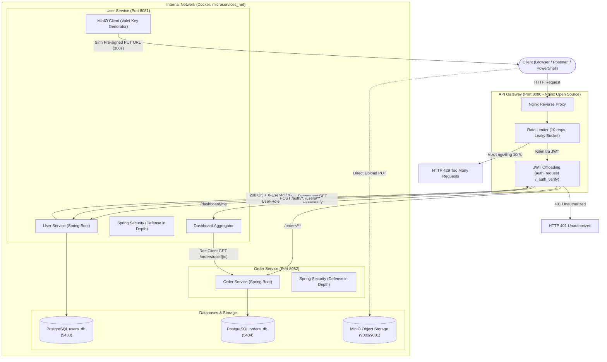

# Bài tập: Thiết kế cho bảo mật bằng các design pattern

Dự án triển khai kiến trúc **Spring Boot Microservices** kết hợp **Nginx API Gateway**, **PostgreSQL** và **MinIO Object Storage**, áp dụng toàn diện các mẫu thiết kế bảo mật (Security Design Patterns) theo nguyên tắc **Defense in Depth**.

---

## 1. Kiến Trúc Hệ Thống & Security Design Patterns



## 2. Yêu Cầu

| Yêu cầu | Thực hiện |
|---|---|
| Routing | Gateway chuyển `/users` sang User service và `/orders` sang Order service |
| Offloading | Gateway kiểm tra JWT HS256 và giới hạn 10 request/giây theo IP |
| Aggregation | `/dashboard` gọi User và Order song song, timeout 1,5 giây, có thể trả kết quả một phần với HTTP 206 |
| Valet Key | User service tạo pre-signed `PUT` URL đến MinIO, đúng một object và hết hạn sau 300 giây |
| Đo độ trễ | `scripts/benchmark.ps1` so sánh gọi thẳng và gọi qua gateway |

---

## 3. Hướng Dẫn Vận Hành Hệ Thống

### 3.1. Các lệnh vận hành trên Windows PowerShell

```powershell
# 1. Đóng gói mã nguồn Java
.\mvnw.cmd clean verify

# 2. Khởi chạy toàn bộ hệ thống bằng Docker Compose (chạy nền)
docker compose up -d --build

# 3. Kiểm tra trạng thái các container (tất cả phải hiển thị UP / healthy)
docker compose ps

# 4. Xem log Gateway Nginx thời gian thực
docker compose logs -f api-gateway

# 5. Dừng hệ thống (giữ nguyên dữ liệu volume)
docker compose down
```

---

## 4. Kết Quả Kiểm Thử & Đo Lường

### 4.1. Kết quả kiểm thử chức năng & an ninh (E2E Tests)

Dự án đi kèm bộ kịch bản tự động hóa bằng PowerShell trong thư mục `tests/`:

1. **Kiểm thử End-to-End toàn diện Gateway (13 test cases)**:
   ```powershell
   powershell -ExecutionPolicy Bypass -File tests\test-e2e-gateway.ps1
   ```
   - **Kết quả**: **13/13 ca kiểm thử đạt (100% Passed)**.
   - Đã kiểm tra: Đăng ký/đăng nhập, từ chối 401 khi thiếu hoặc giả mạo JWT, ẩn route nội bộ `/auth/verify` (404), định tuyến Users và Orders, Dashboard Aggregation, sinh MinIO Pre-signed URL, upload ảnh HTTP PUT trực tiếp và xác nhận avatar.

2. **Kiểm thử Nginx Rate Limiting (10 req/s)**:
   ```powershell
   powershell -ExecutionPolicy Bypass -File tests\rate-limit-test\test-rate-limit.ps1 -TotalRequests 35
   ```
   - **Kết quả**: Gửi 35 requests liên tục $\rightarrow$ **10 requests** đầu tiên được xử lý thành công, **25 requests** tiếp theo bị chặn ngay lập tức với mã **HTTP 429 Too Many Requests**.

3. **Kiểm thử chịu lỗi khi Order Service gặp sự cố (Resilience)**:
   ```powershell
   powershell -ExecutionPolicy Bypass -File tests\test-resilience.ps1
   ```
   - **Kết quả**: Khi dừng container Order Service, Dashboard trả về mã **HTTP 503 Service Unavailable** có kiểm soát; khi khởi động lại, hệ thống tự động phục hồi trả dữ liệu bình thường.

---

### 4.2. Kết quả đo lường hiệu năng: Direct Service vs Nginx API Gateway trên Localhost

#### Bảng số liệu đo lường thực tế

| API Endpoint | Phương Thức | Tổng Request | Thành Công | Lỗi | Error Rate | Mean (ms) | P50 (ms) | P95 (ms) | Min (ms) | Max (ms) |
|---|---|---:|---:|---:|---:|---:|---:|---:|---:|---:|
| **Users** (`/users/me`) | Direct | 50 | 50 | 0 | 0.0% | 31.24 | **26.54** | 53.39 | 13.67 | 64.80 |
| **Users** (`/users/me`) | Gateway | 50 | 50 | 0 | 0.0% | 31.62 | **27.94** | 53.22 | 18.83 | 87.59 |
| **Orders** (`/orders`) | Direct | 50 | 50 | 0 | 0.0% | 33.34 | **31.42** | 53.47 | 17.49 | 87.72 |
| **Orders** (`/orders`) | Gateway | 50 | 50 | 0 | 0.0% | 34.55 | **28.54** | 68.23 | 20.78 | 120.68 |
| **Dashboard** (`/dashboard/me`) | Direct | 50 | 50 | 0 | 0.0% | 36.08 | **31.71** | 51.81 | 22.73 | 129.35 |
| **Dashboard** (`/dashboard/me`) | Gateway | 50 | 50 | 0 | 0.0% | 39.35 | **34.98** | 68.95 | 21.51 | 105.31 |

#### Bảng so sánh Overhead (Gateway vs Direct)

$$\text{Overhead (ms)} = \text{P50 Gateway} - \text{P50 Direct}$$
$$\text{Overhead (\%)} = \left(\frac{\text{P50 Gateway} - \text{P50 Direct}}{\text{P50 Direct}}\right) \times 100$$

| API Endpoint | Direct P50 | Gateway P50 | Overhead P50 (ms) | Overhead P50 (%) | Direct Mean | Gateway Mean | Direct P95 | Gateway P95 | Trạng Thái |
|---|---:|---:|---:|---:|---:|---:|---:|---:|:---:|
| **Users** | 26.54 ms | 27.94 ms | **+1.40 ms** | **+5.28%** | 31.24 ms | 31.62 ms | 53.39 ms | 53.22 ms | Hợp lệ (100% 200 OK) |
| **Orders** | 31.42 ms | 28.54 ms | **-2.88 ms** | **-9.17%** | 33.34 ms | 34.55 ms | 53.47 ms | 68.23 ms | Hợp lệ (100% 200 OK) |
| **Dashboard** | 31.71 ms | 34.98 ms | **+3.27 ms** | **+10.31%** | 36.08 ms | 39.35 ms | 51.81 ms | 68.95 ms | Hợp lệ (100% 200 OK) |

